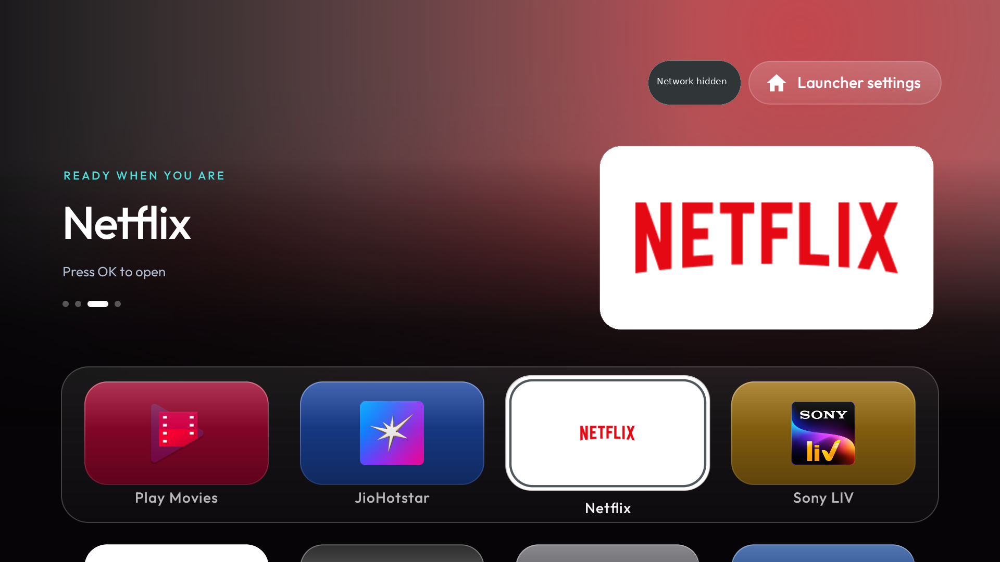
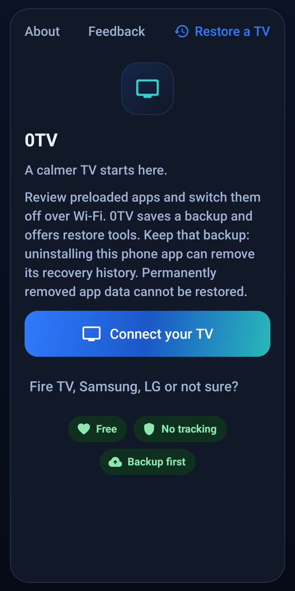
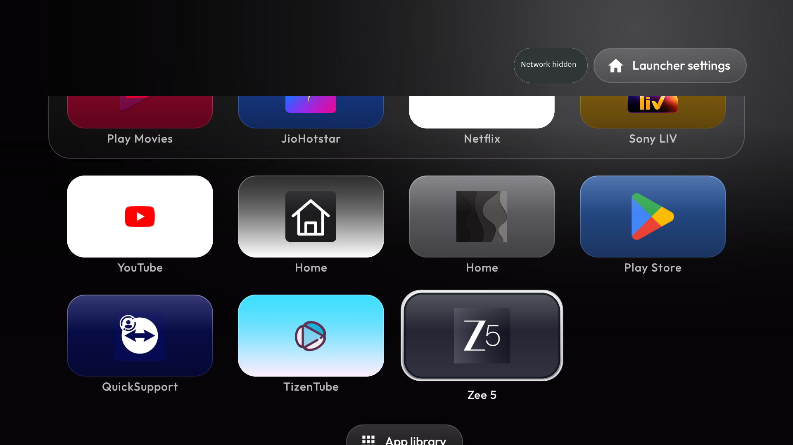

<div align="center">


# 0TV

**Less noise. More television.**

Debloat your Android TV from your Android phone.<br>
No laptop. No desktop. No Claude Code required.

<a href="https://github.com/vio137/0TV/releases/download/v1.0.0-rc8/0TV-1.0.0-rc8.apk"></a>

**[Download APK](https://github.com/vio137/0TV/releases/download/v1.0.0-rc8/0TV-1.0.0-rc8.apk)** · **[Website](https://vio137.github.io/0TV/)** · **[Setup guide](docs/GUIDE.md)**

`1.0.0-rc8` · `Android 8+ phone` · `Free & open source`

Install on your **phone**, not on your TV. The app installs the TV launcher for you.



<sub>Real Xiaomi Mi Box 4 capture. Network name masked. Installed apps vary.</sub>
</div>

## Start here

1. **Install on your phone.** Download the APK above. Open it and allow installation from your browser or Files app if Android asks.
2. **Prepare your TV.** Keep both devices on the same home network. Enable Developer options and USB debugging or Wireless debugging where available. The TV must support network ADB.
3. **Connect and approve.** Open 0TV, choose your TV or enter its current address, and approve the prompt with the TV remote. Wireless debugging uses a fresh pairing code and pairing port, then a connection port.
4. **Review before changing anything.** Let the backup finish. Keep the apps you use, then confirm your choices. Choose **0TV Home** if you want the launcher shown above.

**Updating? Install over your existing 0TV app. Do not uninstall first:** that can erase local recovery history. No separate TV launcher download is needed.

[Step-by-step setup](docs/GUIDE.md) · [Connection help](docs/GUIDE.md#troubleshooting) · [Recovery guide](docs/RECOVERY.md)

## What you can do

1. **Debloat with a backup first.** Review preinstalled apps and disable selected ones. Protected system apps are guarded. Separate removal tools have stronger recovery limits.
2. **Choose a cleaner Home.** Install 0TV Home with large banners and remote-friendly focus, or choose one of the other launcher options.
3. **Use your phone as a remote.** Navigate, enter supported text and launch installed TV apps.
4. **Send files and check storage.** Transfer files, review storage/cache tools and check for apps an update turned back on.
5. **App2TV.** Copy apps installed on your phone, including split APKs, to your TV. Compatibility and space checks run first; phone apps may still need a touchscreen.
6. **Optional YouTube+ / TizenTube Cobalt and J10TV installers.** Download from their upstream GitHub releases with digest, package and signing-certificate checks. These are separate choices, not part of cleanup.
7. **Optional DNS filtering.** Use AdGuard or a custom DNS-over-TLS hostname on compatible Android 9+ TVs. This does **not** block YouTube in-video ads and may affect connectivity.
8. **See your TV's screen.** My TV keeps a private, per-device screenshot. Tap the TV picture for a fresh capture. It is a saved still, not a live stream.

<details>
<summary><b>One extra: the 0TV Home easter egg</b></summary>

Press Up, Up, Down, Down, Left, Right, Left, Right on the TV remote for a cracked-screen effect. Repeat to remove it. This is inside 0TV Home only; it needs no overlay permission. Remote-key behavior has been tested in rendered tests, not on a physical remote.

</details>

## A closer look



*Phone UI render, not a hardware capture.*



*Real TV capture. Network name masked.*

[Explore the website and illustrated guide](https://vio137.github.io/0TV/#guide)

## Know the limits

- **Backup is not a universal undo.** Restore depends on intact records, the same device and prior state. Permanently deleted app data cannot be recovered. Restore does not roll back TizenTube/Cobalt or J10TV installs.
- **TV support varies.** Android TV and Google TV need accessible network ADB. Fire TV has a limited cleanup/remote path, not a promise to replace Amazon's Home. Samsung Tizen and LG webOS are not supported.
- **Keep ADB local.** Never expose it to the public internet or disable connection approval. Keep your physical remote and a recovery route.
- **This is a release candidate.** The launcher has real Mi Box 4 testing. Full phone cleanup/restore, App2TV, J10TV installation and the new tap-to-refresh flow have not been verified end to end on physical hardware. [Exact test scope](docs/TESTING.md).

## Download & verify

If the button does not start a download, use the **[plain APK link](https://github.com/vio137/0TV/releases/download/v1.0.0-rc8/0TV-1.0.0-rc8.apk)** or open **[all releases](https://github.com/vio137/0TV/releases)** and select the APK under Assets.

- **Version:** 1.0.0-rc8 / versionCode 8
- **Package:** `app.tvtidy.cleaner`
- **Phone:** Android 8.0+ (API 26), ARM64 / ARMv7
- **Size:** 24,626,870 bytes

SHA-256:
```text
9a2c296d26a1d0f45bb80d7656325f1997556bd379adc490614ff0a2f2c8acdc
```

On a computer, if you want to verify the file:
```sh
sha256sum 0TV-1.0.0-rc8.apk
```

The app itself does not need a computer. Use this repository's release assets, not a third-party reupload. Local builds use a different signing key unless the original signing identity is supplied.

## Privacy

No account, analytics, automatic update check or automatic feedback upload in this build. The main connection is local ADB. Optional Cobalt and J10TV downloads contact GitHub; optional DNS filtering sends DNS queries to the chosen provider. Feedback uses Android's share sheet, so you choose what to share.

The website has no analytics or third-party scripts. [Privacy and network details](docs/PRIVACY.md).

## Guides & source

- [Install and use 0TV](docs/GUIDE.md)
- [Restore and recovery](docs/RECOVERY.md)
- [Testing and hardware limits](docs/TESTING.md)
- [Build from source](docs/BUILDING.md)
- [Release maintenance](docs/RELEASING.md)
- [Report a problem](https://github.com/vio137/0TV/issues/new/choose)

<details>
<summary><b>For developers: build commands and source map</b></summary>

```sh
git clone https://github.com/vio137/0TV.git
cd 0TV
sh tools/bootstrap-inputs.sh
./gradlew :core:test :adb:test :app:testDebugUnitTest
./gradlew :app:assembleDebug
```

JDK 21 and Android SDK platform 37 are needed for the companion. The launcher fork has its own Gradle project. Signing keys are not included. See [BUILDING.md](docs/BUILDING.md) before building or replacing bundled inputs.

| Folder | Contents |
|---|---|
| `app`, `core`, `adb` | Companion UI, domain logic, transport and tests |
| `launcher-fork/launcher` | Redesigned 0TV Home source |
| `upstream/tv-detox` | Recovered Simple 1.5.7 source snapshot; upstream commit unknown |
| `website` | Static website, guides and screenshots |
| `docs` | Setup, privacy, recovery, test scope and build instructions |

</details>

## Author & credits

**0TV design and customizations: ARNAB MANDAL**<br>
[arnabmandal.com](https://arnabmandal.com) · [arnab@ik.me](mailto:arnab@ik.me) · [GitHub / vio137](https://github.com/vio137)

Built on [TidyTV](https://github.com/jolan94/tidytv), [cleanyourtv](https://github.com/Gathin23/cleanyourtv) by Gathin, and [tv-detox](https://github.com/Ansub/tv-detox) by Ansub. Their MIT notices remain. Kadb is Apache-2.0; spake2-java is GPL-3.0. The combined APK is conveyed under **GPL-3.0**; individual components keep their own licences.

[NOTICE](NOTICE) · [Third-party licences](docs/THIRD_PARTY_LICENSES.md) · [GPL-3.0](LICENSE) · [Inherited TidyTV MIT licence](docs/LICENSE-TIDYTV-MIT.txt)

Not affiliated with Google, Amazon, Netflix, YouTube or TV manufacturers. Shown app logos identify installed apps; trademarks belong to their owners. Inspect and redact logs and screenshots before posting them publicly.
